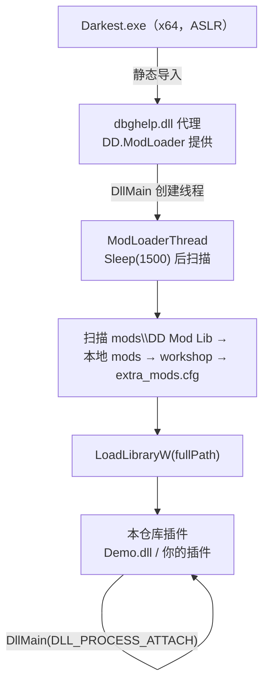
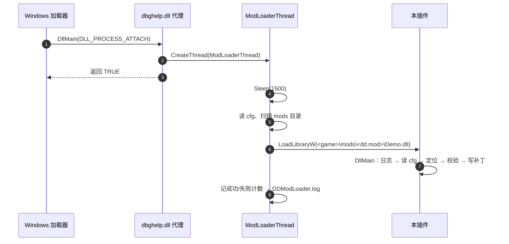
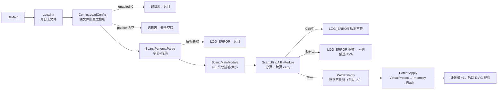

# 架构说明

> 本文描述插件在进程里的位置、加载时序，以及 `Demo` 插件从 `DllMain` 到写入字节的完整数据流。
>
> 事实分级（与 DD.Plugins 一致）：`[代码]` = 本次读过源码并复核；`[文档]` = 来自既有 README/ADR，本次未复跑；`[未确证]` = 无证据或来源矛盾。本文中标注 `[代码]` 的均指本仓库源码；涉及加载器的部分标注 `[文档]`，因为加载器代码不在本仓库，本文只转述其行为。

## 1. 分层

`Darkest.exe` 进程内有两套插件体系并存 `[文档]`（见 `DD.ModLoader/docs/ARCHITECTURE.md`）：

**本仓库只负责最右边那一格。** 插件是"旧式 DLL"：没有必须导出的函数，加载器 `LoadLibraryW` 之后靠 `DllMain` 生效 `[文档]`。

新协议插件（导出 `DDPlugin_Query` / `DDPlugin_Load`）由 `DDCore.dll` 管理，和本模板无关。判断规则是加载器解析 PE 导出表：两个导出都在 → 归 DDCore；否则按旧式 DLL 处理 `[文档]`。

## 2. 加载时序

要点：

- `DllMain` 在**加载器锁内**执行。里面不能长时间阻塞、不能等别的线程、不能调 `LoadLibrary` 去拉起会反向依赖的模块。所以这里只做"读配置 + 扫一遍内存 + 写几字节"。
- 时序与游戏主线程**没有同步**。不要假设某个游戏全局对象此刻已经构造完成；要靠回调/钩子之后再去碰它们。
- 加载失败不会崩游戏，只在 `DDModLoader.log` 记一行失败原因。所以"没有日志"和"日志报错"是两个不同的排查方向。

## 3. Demo 的数据流

各模块职责：

| 模块 | 只做一件事 | 不含什么 |
| --- | --- | --- |
| `Log` | 写文件、节流 | 不做格式化以外的事，不认识插件业务 |
| `Config` | 文本 → 结构体 + 告警列表 | 不写日志（方便离线测试），不决定"启用与否" |
| `Scan` | 特征码 → 命中地址列表 | 不判断"该不该打" |
| `Patch` | 校验 + 写入 | 不搜索、不读 cfg |
| `Hooks` | 编排上述步骤 + 决定降级 | 不含算法细节 |

这样切分的好处：`Scan / Patch / Config` 都能在没有游戏、没有日志系统的环境里被单测覆盖（`demo_test` 就是这么做的）。

## 4. 四种内存落点机制

本模板只演示第四种里最简单的一档（改立即数 / 改字节）。真正写功能时通常会用到下列之一：

| 机制 | 字节形态 | 适用 | 备注 |
| --- | --- | --- | --- |
| `write_detour<N>`（DKUtil） | 入口 `E9 rel32` | 函数入口 hook | DKUtil 负责 stolen 字节与 trampoline，最省事 |
| `jmp rel32` + 自建 trampoline | 5B `E9` + `nop` 补齐 | 目标在 ±2GB 内 | 需要自己搬 stolen 字节 |
| `FF25` 绝对跳 | 14B：`FF 25 00 00 00 00` + 8B 地址 | 目标距主模块 > 2GB | rel32 够不到时唯一选择 |
| 函数内 cave（Xbyak） | 入口 `E9` 进 stub，重放 stolen 后跳回 | stolen 含栈相对写、必须保持 rsp | 最灵活也最容易写错，务必配离线字节断言 |

选型顺序：能用 `write_detour` 就别自己搬字节；跨模块（>2GB）才用 `FF25`；只有入口 hook 破坏栈平衡时才做 cave。

## 5. 构建期生成物

| 生成物 | 来源 | 内容 |
| --- | --- | --- |
| `Plugin.h` | `xmake/Plugin.h.in` | `PLUGIN_NAME` / `PLUGIN_AUTHOR` / `PLUGIN_LICENSE` / 版本号 → `Plugin::NAME/AUTHOR/Version` |
| DLL 版本资源 | `xmake/version.rc` | `CompanyName=AUTHOR`、`ProductName=NAME`、`FileVersion=版本` |

`Plugin.h` 由 `dd.plugin` 规则在 `on_load` 阶段生成到 autogen 目录并加入头文件搜索路径。**不要手写同名文件覆盖它**——手写的会被生成物遮住，或者反过来遮住生成物，行为随构建顺序变化。
